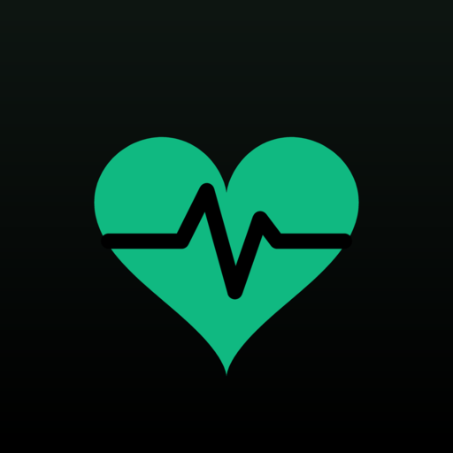
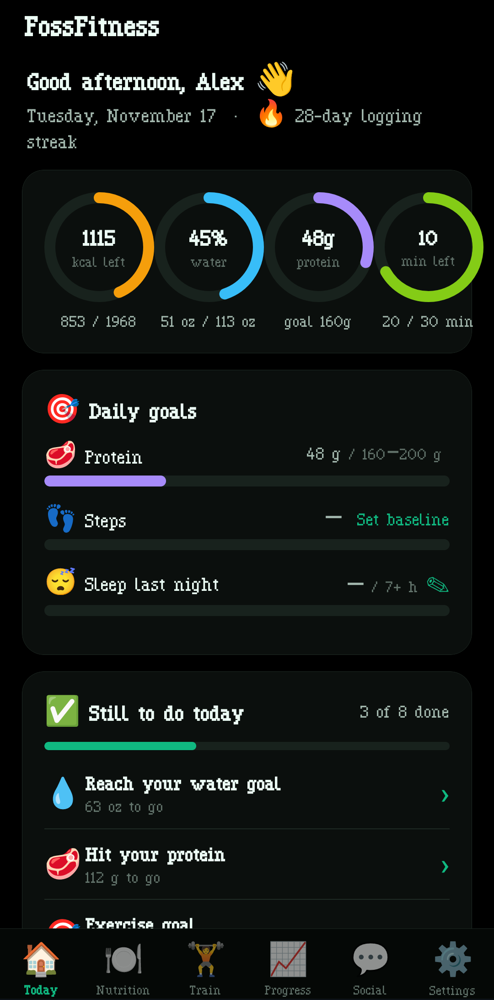
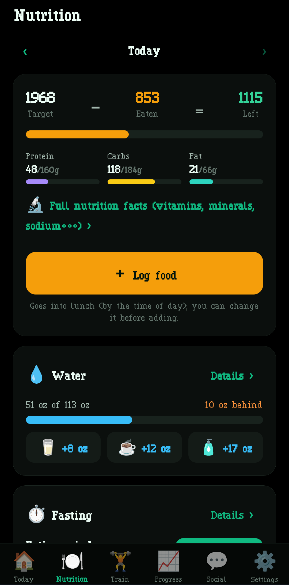
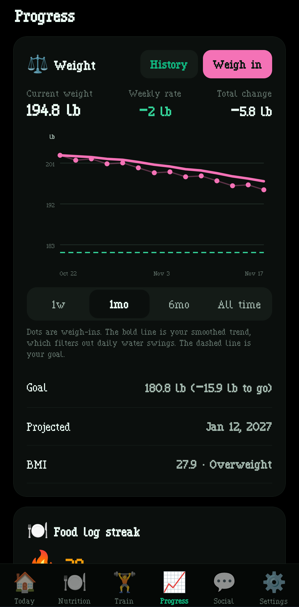
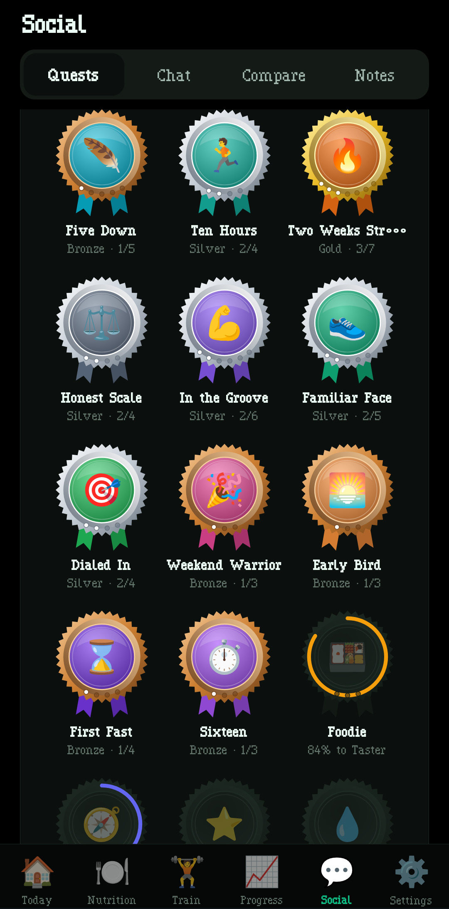

<p align="center">
  
</p>

<h1 align="center">FossFitness</h1>

<p align="center">
  <strong>Track food, water, workouts, fasting and weight, and level up while you do it.</strong><br>
  Free and open source. No ads, no tracking, no Google.
</p>

<p align="center">
  <a href="../../releases/latest"></a>
  <a href="LICENSE"></a>
  
  <a href="../../actions/workflows/build.yml"></a>
</p>

<p align="center">
  
  
  
  
</p>

## Why FossFitness

Most fitness trackers are free because *you* are the product: your meals, weight and habits feed ads and analytics.
FossFitness is different:

- 🔒 **Your data stays yours.** Everything runs on your phone. Without an account, the app sends nothing anywhere.
- 🚫 **No ads, no analytics, no tracking.** And no Google services at all: no Firebase, no Play services, no ML Kit.
- 🏠 **Friends and family, on your own terms.** Want to chat, compare progress or back up your history? Run your own
  [HealthHub](https://github.com/merlinlcb/HealthHub) server and invite the people you choose.
- 🎮 **Built to keep you going.** XP, levels, streaks, daily quests and medals make showing up every day a game.

## Features

### 🍽️ Nutrition
- **Over 40,000 foods**, offline: about 12,000 from USDA FoodData Central and about 29,000 menu items from 96 US
  restaurant chains.
- Full **nutrition facts** with vitamins and minerals.
- **Scan a Nutrition Facts label** with the camera. It's read on the phone with Tesseract, so the photo goes nowhere.
- Your own foods, favourites, and **saved meals** that log a whole dinner in one tap.

### 💧 Daily tracking
- Daily rings for **calories, protein, water and exercise**, worked out from your own numbers.
- Water goals that rise with your activity.
- An **intermittent fasting** timer with the stages of your fast.
- A **weight trend** that smooths out daily water swings, with a projected goal date.

### 🏋️ Training
- About **150 exercises**: gym, home, cardio and sports.
- A suggested weekly plan, or build your own, with set and rep logging.
- Reads steps, sleep, weight and workouts from **Health Connect** (read only).

### 🏅 The game
- XP, levels and streaks.
- New **daily quests** every day.
- **18 medal families**, each climbing from bronze to obsidian.

### 💊 Health trackers (optional, off by default)
- Tick off **medications**, with reminders at the times you set.
- Chart **blood pressure, blood sugar, heart rate** or anything else you measure, against your own target range.
- Extra private: kept only on the phone and in backups you export. Never sent to a server, never shown to others,
  never part of XP or medals.

### 🔔 Reminders and looks
- Gentle local reminders for water, meals, medications, fasting, weigh-ins and an evening summary.
- Dark, light, follow your phone, or switch by time of day.

### 👥 With a server (optional)
- Chat and shared notes with your group.
- **Compare**: everyone's weight trend and which daily goals they hit (never what they ate).
- A **weekly XP race**.
- Shared custom foods.
- Backup, and restore everything on a new phone.

## Install

| Where | How |
|---|---|
| **GitHub** | Download `FossFitness.apk` from the [latest release](../../releases/latest) and open it on your phone. The app tells you when an update is ready. |
| **F-Droid** | Coming soon. |

Needs Android 8.0 or newer.

## Your own server

The group features use **[HealthHub](https://github.com/merlinlcb/HealthHub)**, a small self-hosted server: one
Python file and SQLite, with no other dependencies. Run it at home or on any small server, share an invite code
with your family or friends, and sign in from the app under **Settings → App settings → Cloud sync**.

## Privacy

| | What happens to your data |
|---|---|
| **No account** | Nothing leaves your phone. Android cloud backup is turned off; backups are files you export yourself. |
| **Signed in** | The app talks only to the server you chose, and to no other host. The server's admin can see the group's synced history. Other members see levels, streaks, XP, chat, shared notes and the Compare view, never your food log. |
| **Health trackers** | Never synced. They stay on your phone and in your own backups. |
| **Label scanning** | Done entirely on your phone. |

## Contributing

FossFitness is built to be community maintained, and help is very welcome: bug reports, ideas, code, data and
docs.

- **[CONTRIBUTING.md](CONTRIBUTING.md):** how the app is put together, where everything lives, how to build and
  test it, and how changes are reviewed.
- **[AGENTS.md](AGENTS.md):** extra rules for bots and AI agents.
- **[SECURITY.md](SECURITY.md):** report a security problem privately.

Quick start for developers:

```bash
cd app
npm ci           # also applies the patches in app/patches
npm test
npm run lint
npx expo run:android
```

## License

FossFitness is free software under the [GNU General Public License v3.0 or later](LICENSE).
Food data comes from USDA FoodData Central and NYC's MenuStat. All third-party code and data are listed in
[NOTICE.md](NOTICE.md).
